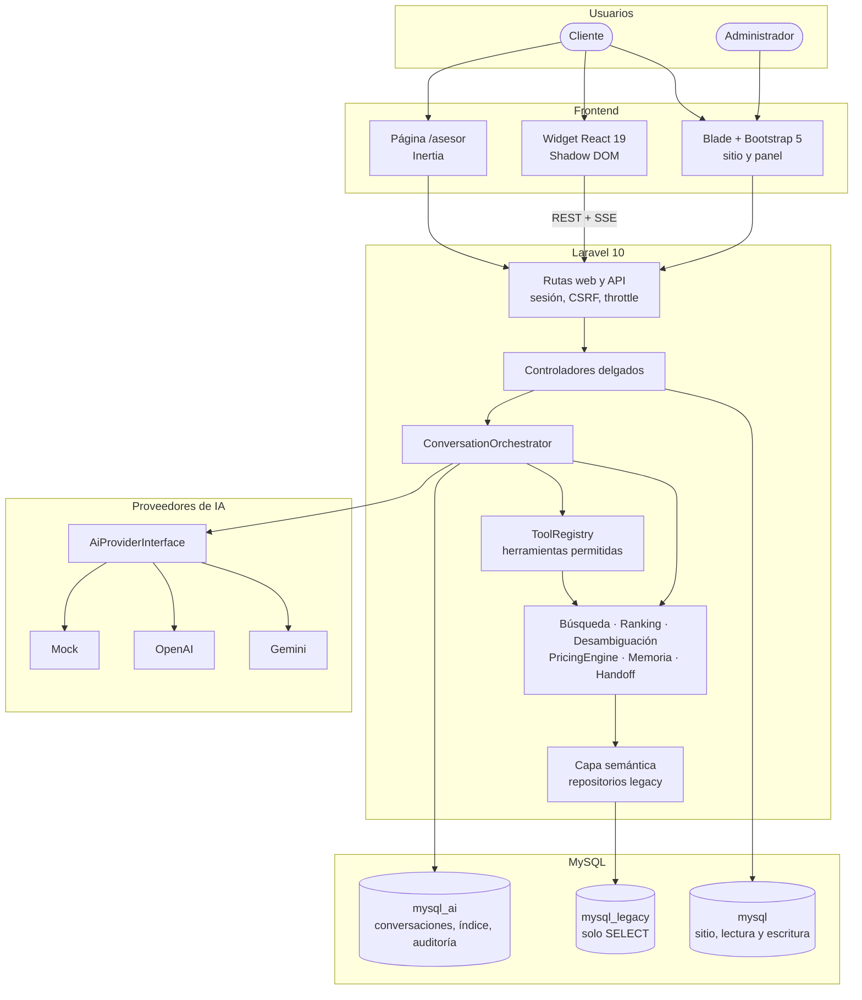
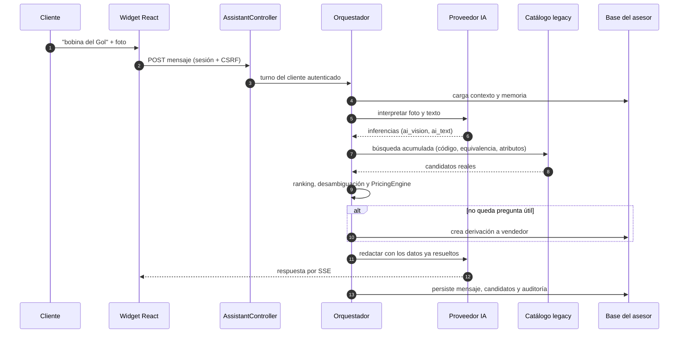
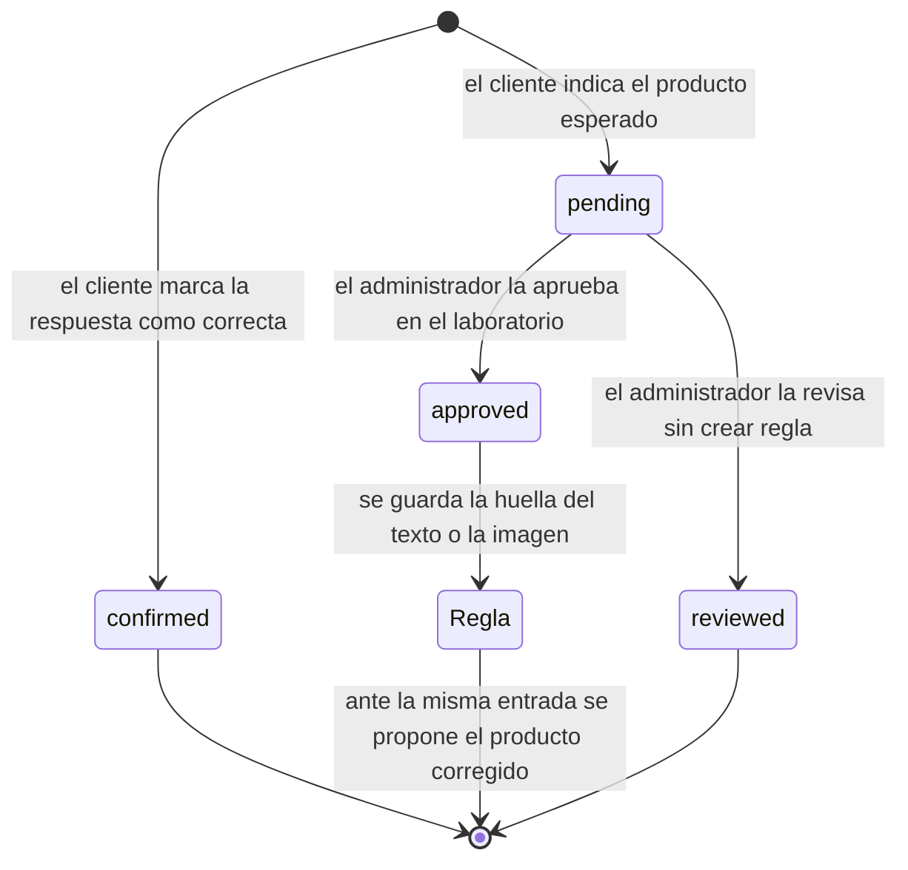
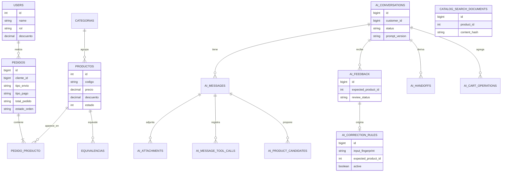

<div align="center">



<br/>

**La IA interpreta. La aplicación decide. La base de datos confirma.**


<br/><br/>


<br/><br/>

Tienda B2B y Zona de Clientes de **BMH Bobinajes** (repuestos eléctricos para automotores),<br/>
ampliada con un **asesor técnico-comercial** que entiende mensajes incompletos, códigos parciales y fotos.

</div>


##  Contenido

- [El problema](#-el-problema)
- [La solución](#-la-solución)
- [Funcionalidades](#-funcionalidades)
- [Arquitectura](#-arquitectura)
- [Flujos de trabajo](#-flujos-de-trabajo)
- [Modelo de datos](#-modelo-de-datos)
- [Criterios y decisiones](#-criterios-y-decisiones)
- [Stack](#-stack)
- [Estructura del repo](#-estructura-del-repo)
- [Puesta en marcha](#-puesta-en-marcha)
- [Pruebas y calidad](#-pruebas-y-calidad)
- [Despliegue](#-despliegue)
- [Estado y pendientes](#-estado-y-pendientes)
- [Licencia y autoría](#-licencia-y-autoría)

##  El problema

Un mostrador de repuestos eléctricos recibe pedidos como «la bobina del Gol que vino la otra vez» o una foto borrosa de un regulador. El catálogo de BMH tiene unos 5.000 productos con **74 atributos técnicos guardados en columnas posicionales** (`columna_57` es «terminales descripción»), códigos duplicados y equivalencias entre marcas. Identificar la pieza correcta dependía de que un vendedor la reconociera, y cotizarla, de aplicar a mano la fórmula de descuentos del cliente.

##  La solución

Una aplicación Laravel que ya resolvía catálogo, clientes, carrito y pedidos, más un **asesor conversacional** dentro de la Zona de Clientes que:

- interpreta texto, códigos y fotos con un proveedor de IA (Gemini, OpenAI o un Mock que funciona sin clave);
- busca y rankea candidatos **contra el catálogo real**, con lógica determinística;
- pregunta lo justo para desambiguar y cotiza con **la misma fórmula que usa el carrito**;
- deriva a un vendedor cuando no queda una pregunta útil.

| Rol | Qué hace |
|---|---|
| **Cliente** | Navega el catálogo con su precio, arma pedidos, repite compras y consulta al asesor |
| **Administrador** | Gestiona productos, categorías, atributos, clientes, pedidos, contenido, imágenes y listas de precios; revisa el laboratorio de IA |
| **Vendedor** | Recibe las derivaciones del asesor con el contexto de la conversación |

##  Funcionalidades

<details open>
<summary><b>Sitio comercial y Zona de Clientes</b></summary>

- Catálogo público y privado con búsqueda tolerante a errores, filtros, ofertas, equivalencias, aplicaciones y piezas relacionadas.
- Registro e inicio de sesión de clientes con validación del estado de la cuenta; guard separado para administradores.
- Precios personalizados por cliente, historial y **repetición de pedidos**.
- Carrito con descuentos e IVA, generación de pedidos y aviso por correo; provincias y localidades con la API Georef.
- Margen de reventa calculado desde el costo del cliente.
</details>

<details open>
<summary><b>Panel administrativo</b></summary>

- Productos, categorías, subcategorías, atributos, clientes, pedidos, novedades, apariencia, descargas y listas de precios.
- Biblioteca de imágenes: las fotos se asignan solas con el código del producto como nombre y se puede elegir dónde va cada una.
- Importación y exportación en Excel (PhpSpreadsheet); «Descargar Excel» baja solo lo filtrado.
- **Laboratorio de IA** (`/dashboard/ia/pruebas`): conversaciones de prueba aisladas de los clientes, revisiones con expectativas estructuradas y aprobación de correcciones.
</details>

<details open>
<summary><b>Asesor técnico IA</b></summary>

- Widget flotante en la Zona de Clientes (React en **Shadow DOM**, sin chocar con Bootstrap) y vista completa `/asesor` con Inertia.
- Chat por REST con **streaming SSE**, adjuntos de imagen y comparación lado a lado de candidatos.
- Búsqueda híbrida: código exacto, equivalencia, atributos, texto `FULLTEXT`, visión e historial del cliente.
- **Memoria estructurada** que separa hechos `confirmed`, `inferred` y `unknown`.
- Herramientas controladas para el modelo (`search_by_code`, `compare_products`, `get_customer_price`, `request_human_assistance`…): la IA nunca ejecuta SQL.
- Agregar al carrito desde el asesor: el navegador solo manda ids y cantidad; el precio se recalcula en el servidor.
- Feedback del cliente → revisión del administrador → **regla de corrección aprobada** que se reaplica ante la misma entrada (huella del texto o de la imagen).
- Índice visual del catálogo para reconocer fotos del propio catálogo.
- Beta cerrada por lista de clientes (`AI_ACCESS_MODE=allowlist`).
</details>

<details>
<summary><b>Comandos de mantenimiento</b></summary>

`bmh:catalog-sync` (índice idempotente) · `bmh:index-catalog-images` · auditoría y normalización de atributos y unidades · optimización de imágenes a WebP · reporte de imágenes faltantes · diagnóstico de la IA.
</details>


##  Arquitectura



**Monolito Laravel** (MVC con Blade) al que se le sumó una capa de dominio para el asesor. Una **capa anticorrupción** aísla el esquema heredado: solo los repositorios `LegacyBmh*` conocen el SQL viejo, y `CatalogSemanticLayer` traduce las columnas posicionales a atributos con nombre.



Reglas que sostienen el diseño (detalle en [`docs/architecture.md`](docs/architecture.md) y [`docs/ai-architecture.md`](docs/ai-architecture.md)):

- **Tres conexiones a MySQL**: el sitio escribe en `mysql`; el asesor lee el catálogo por `mysql_legacy` con un usuario que solo tiene `SELECT` (si intentara escribir, MySQL lo rechaza); sus datos propios van a `mysql_ai`.
- **Sin foreign keys entre bases**: las tablas del asesor referencian clientes y productos por id, para no acoplar el esquema nuevo al viejo.
- **El tenant es el cliente de la sesión**: el asesor nunca acepta un `customer_id` del navegador.
- **Interfaces del dominio** (`CatalogRepositoryInterface`, `PricingRepositoryInterface`…) atadas en `BmhAdvisorServiceProvider`: cuando BMH normalice su esquema, se cambia el binding y nada más.

##  Flujos de trabajo

### Un turno del asesor

El orden es el corazón del diseño: cuando le toca hablar al modelo, **qué producto y a qué precio ya están decididos**.



### Corrección aprobada




##  Modelo de datos

Entidades principales del sitio (base heredada) y del asesor (base `mysql_ai`, migración `2026_08_10_000100_create_bmh_advisor_tables.php` y siguientes):



`CATALOG_SEARCH_DOCUMENTS` es el índice materializado (con `FULLTEXT`) que `bmh:catalog-sync` reconstruye con hash de contenido; no toca la base legacy.

##  Criterios y decisiones

| Decisión | Por qué |
|---|---|
| La IA solo interpreta y redacta | Producto, ranking, precio y stock son determinísticos; el modelo no puede inventar un importe |
| Replicar la fórmula de producción en `PricingEngine` | `precio × (1 − desc. producto) × (1 − desc. cliente)`, IVA al cerrar el carrito: cotizar distinto del carrito destruye la confianza ([`docs/pricing-rules.md`](docs/pricing-rules.md)) |
| Sin vector store ni Elasticsearch | Con ~5.000 productos, MySQL `FULLTEXT` responde en milisegundos; los embeddings están configurados pero apagados |
| Usuario de solo lectura para el catálogo | El asesor no puede romper el sitio aunque tenga un error |
| Reutilizar el login de la Zona de Clientes | Un segundo login sería superficie de ataque nueva |
| Shadow DOM para el widget | Tailwind y React conviven con las páginas Bootstrap sin colisiones de estilos |
| Mock como proveedor por defecto | La demo y las pruebas corren sin API key |
| Derivar solo si no queda pregunta útil | Derivar teniendo una pregunta disponible es renunciar antes de tiempo |
| La similitud visual pesa menos que un código exacto | Un código leído en una foto es una inferencia, no un hecho |
| Productos con `estado = 0` fuera de resultados | Son productos despublicados |

##  Stack

| Capa | Tecnología | Versión |
|---|---|---|
| Backend | PHP · Laravel · Sanctum · Inertia Laravel | ^8.1 · 10.48.12 · 3.3 · 2 |
| Sitio y panel | Blade · Bootstrap · Alpine.js | 5.2.3 · 3 |
| Asesor | React · TypeScript · @inertiajs/react · Tailwind CSS · Radix UI · Motion | 19.2.8 · 7.0.2 · 2.3.27 · 3.4.1 · 1.x · 13 |
| Build | Vite · laravel-vite-plugin | 5.4.21 · 1 |
| Datos | MySQL (3 conexiones lógicas), índice `FULLTEXT` | — |
| IA | Gemini · OpenAI · Mock detrás de `AiProviderInterface` | modelos por variable de entorno |
| Integraciones | Georef (Argentina) · reCAPTCHA · Laravel Mail · PhpSpreadsheet 2.1 · Guzzle 7 | — |
| Calidad | PHPUnit · Laravel Pint | 10.5 · 1 |

##  Estructura del repo

```text
app/
├── Domain/              catálogo, búsqueda, precios, pedidos e inventario (contratos + repositorios legacy)
├── Services/Ai/         orquestador, proveedores, memoria, herramientas, carrito y correcciones
├── Http/                controladores, middleware (customer.api, assistant.access) y validaciones
├── Models/  Models/Ai/  modelos del sitio y del asesor
└── Console/Commands/    sync del índice, auditoría, normalización, imágenes y diagnóstico
database/migrations/     esquema comercial, normalización y tablas del asesor
resources/js/            asesor React/Inertia y widget
resources/prompts/       prompts versionados
resources/views/         Blade del sitio y del panel
routes/                  web.php, auth.php y assistant.php (asesor + laboratorio)
tests/Feature/Bmh/       suite principal del asesor y del dominio
docs/                    arquitectura, IA, búsqueda, precios, seguridad, datos y despliegue
```

##  Puesta en marcha

Requisitos: PHP 8.1 o superior (la documentación usa 8.5 en local), Composer 2, Node.js 20+ y MySQL/MariaDB. Hace falta una copia **autorizada** del esquema legacy; los datos reales no se distribuyen.

```bash
composer install
npm install --legacy-peer-deps
cp .env.example .env && php artisan key:generate
```

Configura en `.env` las tres conexiones y deja `AI_PROVIDER=mock` si no vas a usar servicios externos:

| Grupo | Variables |
|---|---|
| Sitio | `DB_CONNECTION`, `DB_HOST`, `DB_PORT`, `DB_DATABASE`, `DB_USERNAME`, `DB_PASSWORD` |
| Catálogo (solo lectura) | `DB_LEGACY_DATABASE`, `DB_LEGACY_USERNAME`, `DB_LEGACY_PASSWORD` |
| Asesor | `DB_AI_DATABASE`, `DB_AI_USERNAME`, `DB_AI_PASSWORD` |
| IA | `AI_PROVIDER`, `AI_FALLBACK_PROVIDER`, `AI_API_KEY`, `AI_ENABLED`, `AI_VISION_ENABLED`, `AI_CHAT_MODEL`, `AI_VISION_MODEL`, `AI_FAST_MODEL`, `AI_EMBEDDING_MODEL`, `AI_MAX_TOKENS_PER_CONVO` |
| Beta | `AI_ACCESS_MODE` (`allowlist` o `all`), `AI_ALLOWED_CUSTOMER_IDS`, `AI_TEST_CUSTOMER_ID` |
| Índice visual | `AI_CATALOG_IMAGE_INDEX_ENABLED`, `BMH_CATALOG_IMAGES_PATH` |
| Correo | `MAIL_MAILER`, `MAIL_HOST`, `MAIL_PORT`, `MAIL_FROM_ADDRESS` |

Con la base legacy cargada y la del asesor creada:

```bash
php artisan migrate --database=mysql_ai --path=database/migrations/2026_08_10_000100_create_bmh_advisor_tables.php
php artisan bmh:catalog-sync
npm run build && php artisan serve
```

La guía paso a paso del asesor (bases locales, usuarios de demo, cómo probar el flujo en el navegador) está en [**README-ASESOR.md**](README-ASESOR.md); la normalización del catálogo, en [`docs/normalizacion-catalogo-runbook.md`](docs/normalizacion-catalogo-runbook.md).

##  Pruebas y calidad

```bash
php -d memory_limit=512M vendor/bin/phpunit --testsuite=BMH
```

- `tests/Feature/Bmh/` tiene 35 archivos y unos 378 métodos de prueba (conteo estático del código). La última corrida documentada reportó **411 pruebas y 2.730 aserciones** en verde con PHP 8.5; no se volvió a correr para este README.
- Cubren autenticación, aislamiento entre clientes, prompt injection, privacidad, subida de imágenes, streaming, proveedores, búsqueda, ranking, visión y precios (incluido que `PricingEngine` coincida con la fórmula de producción).
- Necesitan una copia de solo lectura del catálogo y bases de prueba desechables (ver `phpunit.xml`).
- Los tests heredados de Breeze (`tests/Feature/Auth`) fallan desde antes del asesor porque dependen de tablas que las migraciones no crean.
- No hay pruebas E2E, de carga ni pipeline de CI.

##  Despliegue

Manual, en hosting Linux con cPanel ([`docs/deployment.md`](docs/deployment.md)):

1. Configurar `.env` de producción con la conexión legacy de solo lectura y `APP_DEBUG`/`AI_DEBUG` apagados.
2. Crear la base del asesor y migrarla.
3. Compilar los assets (`public/build` no se versiona) y subirlos.
4. `php artisan config:cache`, `route:cache` y `view:cache`.
5. Programar `bmh:catalog-sync` y, si se usa el índice visual, `bmh:index-catalog-images` (cron diario).

No hay Docker, CI/CD ni infraestructura como código. La cola es síncrona y los correos salen en la misma solicitud.

##  Estado y pendientes

- **Último commit:** 5 de noviembre de 2026 (`feat: fortalecer correcciones y comparación visual del asesor IA`), en la rama `main`.
- El asesor está implementado y probado; el acceso se limita a una lista de clientes (beta cerrada). Si la versión actual está en producción **no está verificado** desde el repositorio.
- Pendientes documentados: búsqueda semántica con embeddings (apagada a propósito), panel de métricas del asesor (los datos ya se registran en `ai_audit_logs`, `ai_feedback` y `ai_handoffs`), pruebas E2E y antivirus para adjuntos.
- Riesgos heredados del sitio: una clave de reCAPTCHA incrustada en el código antiguo (hay que rotarla y pasarla al entorno), vistas Blade que renderizan HTML administrable sin escape y el middleware CSP desactivado en el grupo `web`.

##  Licencia y autoría

Software propietario de BMH. Todos los derechos reservados: no se distribuye ni se publica sin autorización. Los dumps SQL, imágenes y datos de clientes que hay en la carpeta de trabajo **no** forman parte de lo publicable.

Según el historial de git, el sitio comercial lo desarrolló principalmente **BruninAlv61**, y **Ing. Santiago Abasto** diseñó e integró el asesor técnico IA (capa anticorrupción, búsqueda, precios, orquestación, seguridad y pruebas).

<div align="center">
<br/>

<sub>BMH · catálogo técnico, pedidos y asesor IA para repuestos eléctricos automotores</sub>
</div>
